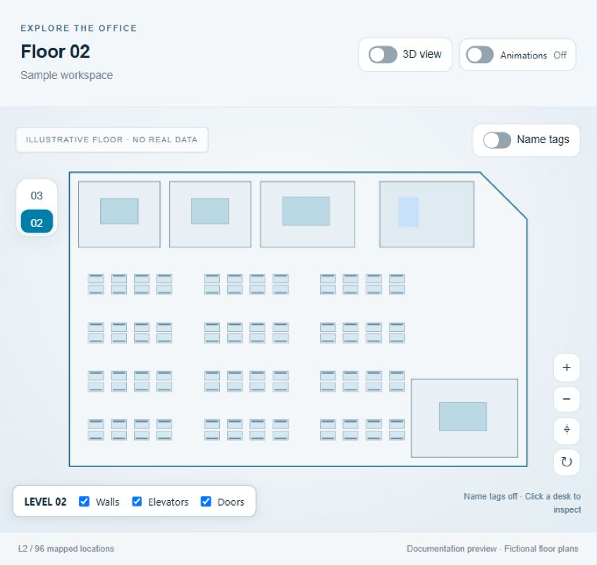
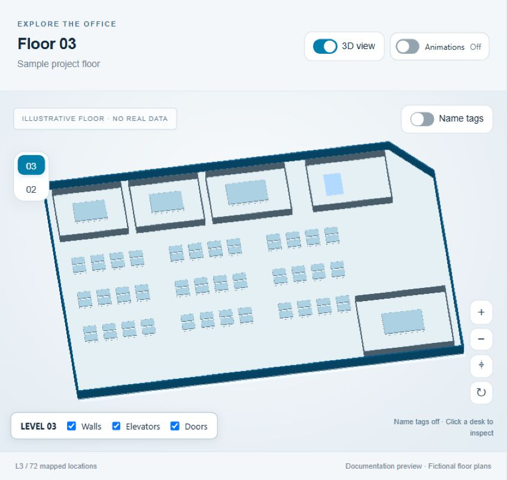

# Atlas 6.9.2

**One workspace to find people, locate equipment and get IT work done.**

Atlas is a self-hosted Windows IT support and administration tool with a browser interface. It connects interactive office floor plans, directory users, machine inventory, application deployment and remote administration. Start with a colleague, a computer or a desk, then follow the links to the information and actions you need.

The **map** helps you explore floors and seating in 2D or 3D. The **IT console** brings user lookup, linked machines, health checks and deployment into one workspace. Both share the same command palette, package catalogue and detail panels. A separate **read-only demo/viewer** lets colleagues browse maps and look up people and stored machine details from their own browsers.

## What Atlas can do

| Area | Capabilities |
| --- | --- |
| **Office maps** | Explore multiple floors in 2D and 3D, search desks and rooms, locate colleagues, and manage seating and directory links. |
| **People and machines** | Search directory and inventory exports; inspect accounts, organisation details, assigned machines, last recorded users and original export fields. |
| **Remote administration** | Check machine health and specifications, inspect software and resource usage, manage processes with confirmation, and open Windows support tools. Remote actions use the host account's existing permissions. |
| **Application deployment** | Browse a package catalogue, select install/repair/uninstall scripts, deploy to individual targets or a bulk queue, and follow progress, logs and history. |
| **Data management** | Preview and apply directory imports, review export-column coverage, maintain seating records, and back up or restore the database. |
| **Shared viewer** | Host a separate read-only interface on the local network for maps, people lookup and stored inventory. Editing, deployment and elevated remote operations stay in the admin tool. |

Atlas runs from Python source with FastAPI and SQLite; the interface uses HTML, CSS and JavaScript. The Windows launcher starts the local admin service and shared viewer together. Runtime records live in a persistent database, while deployment packages stay in your configured package repository.

## Map previews

These are screenshots of the Atlas renderer using **entirely fictional floors and sample desks**, with name tags disabled. They contain no real names, accounts, hostnames, IP addresses, seating assignments or office-plan geometry. The layouts illustrate the interface and are not the actual office floors.

| 2D floor navigation | 3D floor exploration |
| --- | --- |
|  |  |

[How the screenshots are produced](docs/images/README.md) · [How to run Atlas](#how-to-run-windows) · [Configuration and updates](#configuration-and-updates)

## How to run (Windows)

### First-time setup

1. On this GitHub repository, select the **main** branch, then **Code → Download ZIP**.
2. Right-click the downloaded ZIP and choose **Extract All**. Open the extracted folder containing `Install_Dependencies.bat` and `Start-Office-Atlas.bat`. Keep all files and subfolders together and run the scripts from the extracted folder.
3. Install **Python 3.12** if it is not already installed, including the Python launcher (`py`). `Python_Settings.bat` detects it through `py -3.12`. If your organisation provides Python elsewhere, set `WMI_PYTHON` to that interpreter's full executable path.
4. Double-click **`Install_Dependencies.bat`**. Wait for **Dependencies installed** and press a key to close the window. This installs the Python packages listed in `requirements.txt` and needs access to your configured Python package index.
5. Double-click **`Start-Office-Atlas.bat`**. It starts both the admin tool and the read-only viewer, then opens two browser tabs.

**Normal startup: `Start-Office-Atlas.bat`.** Dependency installation is needed for the first setup, after changing Python, or when an update changes `requirements.txt`.

Git and Node.js are not needed to run the downloaded application. The download includes the application, maps and initial directory database. Application installers used for deployment stay in your separate package repository; select its folder in admin **Settings** before deploying.

This is a normal project tree containing Python source, browser assets, floor plans, templates and tests. No TXT-to-Python extraction is needed.

If you already use Atlas, follow [Configuration and updates](#configuration-and-updates) to retain your live database and settings when updating.

After updating and restarting Atlas, refresh any open browser tabs. Console scripts and styles use versioned URLs, and admin pages revalidate cached files so an older console script cannot keep adding removed interface sections. API responses are not cached.

### Open and share Atlas

| Interface | Address | Access |
| --- | --- | --- |
| Your admin tool | `http://127.0.0.1:8770` | Local computer only; existing editing and IT operations |
| Shared read-only viewer | `http://YOUR-IP:8771` | People on your reachable network; maps and directory lookup |

Use the host computer's Wi-Fi/Ethernet IPv4 address in place of `YOUR-IP`. The launcher prints candidate addresses and saves them in `data/share-addresses.txt`. Share the address belonging to the network your colleagues use. The viewer requires only a browser, not Python or Windows elevation on their computers.

**`Stop-Office-Atlas.bat` stops both servers.** Finish active deployments before stopping. Starting again reuses this folder's running servers. Occupied ports fail with an error rather than attaching to another installation. Closing a browser tab does not stop hosting.

To change ports, set `ATLAS_ADMIN_PORT` and `ATLAS_VIEWER_PORT` before launching; they must be different. Logs are in `logs/admin-startup.log` and `logs/viewer-startup.log`.

### If startup fails

- **Python 3.12 not found:** install Python 3.12 with the launcher, or configure `WMI_PYTHON` as described above.
- **Dependency installation failed / Dependencies missing:** rerun `Install_Dependencies.bat` and check its error message; dependencies must be installed for the same Python that starts Atlas.
- **Startup failed / port occupied:** check the startup log named in the error. If this folder has an unresponsive Atlas server, run `Stop-Office-Atlas.bat` before starting again. If another application uses the port, choose different Atlas ports.
- **Browser tabs did not open:** try `http://127.0.0.1:8770` for admin or `http://127.0.0.1:8771` for the viewer after a successful startup.

## One command palette across Atlas, the IT console and the shared viewer

Press **Ctrl+K** (or **Cmd+K** on a Mac browser), or click **Search Atlas** in either header. Search people, machines, desk codes, teams and admin views in one place. Use arrow keys and Enter to open a result, and Escape to close.

Use `person:`, `machine:`, `desk:` or `>` to narrow results. People with a single mapped desk open on the map; multiple locations offer a choice. Unmapped people and machines open selected in the existing IT console. Name-only desk matches are identified as unconfirmed. Actions open the existing admin interface and keep its review/confirmation flow. Both admin views load the same component, isolated stylesheet and 29-command catalogue. Commands belonging to the other view navigate there; selected machines carry across where available. Deployment, file-access and remote-operation commands open their existing controls for review. The shared viewer uses the same component, styling, keyboard controls and animation setting, with eight read-only commands: lookup, map, 2D/3D, reset, refresh, export, animations and shortcut help. Its person and machine results stay inside the read-only viewer.

## Shared viewer

- Explore the same ten-floor 2D/3D map, search seating, inspect desk records, and export the displayed records.
- Use **Ctrl+K / Search Atlas** or **User lookup** to search the Europe-wide directory by name, account, email, BRID or machine name. Open a person to see their linked machines and mapped desks. Inspect a machine to see stored inventory, assignment/logon relationships, linked people and recorded desks; copy its stored report when needed.
- Both processes read the same runtime database (`data/office_atlas.db` by default). **Refresh records** reloads seating changes made in the admin interface; directory queries read the current database on each request.
- Read-only means no seating edits, imports, settings changes or deployment actions. Live remote health/software checks that use the host's privileges are unavailable. Stored inventory details remain visible.

The viewer is a separate FastAPI application with only explicitly registered read routes. It does not import or register the admin backend. SQLite is opened with `mode=ro` and `query_only`; mutation requests receive HTTP 403. Administrative GET endpoints, full-database downloads and server files are not served. The admin interface retains its loopback and same-origin checks. Browser controls are hidden for clarity; the server enforces the restrictions.

The host must remain awake and network-reachable. Windows Firewall or your organisation's firewall must allow inbound TCP on the viewer port (8771 by default). If colleagues cannot connect, check that rule and the selected network/IP; changing the admin bind address is unnecessary. The launcher does not change firewall policy. This is an unauthenticated internal viewer: anyone who can reach its port can read the displayed directory and maps.

## Machine details

The console, map and shared viewer use the same Atlas header, blue eagle branding and sidebar dimensions. The console keeps its Workspace, Remote Admin, Bulk Deploy and History navigation below the header. Map import, export and database backup actions are grouped under **More**.

Application deployment appears beneath **History** in the left sidebar after selecting a target in Workspace, giving the directory and machines the full remaining width. Open the package selector to search or choose a favourite/recent package; Escape restores the previous selection. **Install / Repair / Uninstall** choose the action. **Advanced** contains threads, fresh copy, alternative execution modes and package checks. The sidebar scrolls on shorter screens; on phones, use the floating **Deployment · hostname** button. Selection is retained when minimized, and clearing the target hides the panel. A job's compact status and expandable log appear only for its original target; failures open the log automatically.

**Package catalogue** opens the same dialog within the console or map, without navigating away. Browse packages, inspect scripts and edit display names or versions. Closing it returns to your current view and preserves the selected target and deployment form.

In the IT console, scrolling past the full person card or live-health panel reveals a compact floating version above the machine list. The person card keeps name, account, email, team and office visible; health chips show the selected target's existing readings. Click either heading to return to the full panel. The cards disappear when their original panels return into view, the lookup is cleared, or you leave Workspace. Scrolling does not run additional health checks; refresh from the full health panel or the machine's right-click menu. Hover a health chip for the full reading and its check time.

Right-click a linked machine to refresh health, open Remote Desktop, Computer Management or Event Viewer, or use the existing copy, remote assistance, file, deployment and inventory actions. Actions use the right-clicked machine. The menu stays within the screen and scrolls when needed; use the mouse wheel or arrow keys, Home/End to reach the first/last option, and Escape to close it. Remote tools use the host computer's current account and existing access permissions.

Expand **Machine details** in the IT console, admin map or shared viewer to inspect the machine's stored export fields. Identity shows infrastructure category, manufacturer, model, serial number, correlation ID, record class and description when supplied. Ownership distinguishes the assigned person from the inventory's last logged-on user. Discovery shows the inventory status, discovery source and the discovery/update timestamps. Machine reports use the same fields.

Empty optional fields are omitted. An absent assignment or last user is labelled **Not supplied**. **Operational** is an inventory status, not proof that the machine is online; last logged-on user does not identify a current session. The current computers export does not supply CPU, disk capacity/free space, BIOS, Citrix registration or maintenance state. Available live specifications remain in the admin health/specifications tools.

## Use every directory export column

The included export supplies **14 person columns and 14 machine columns**. All are mapped to the directory database. Person details show **Department**, **Business unit** and **Organisation** separately. Excel serial values in **Last login time** display as readable dates and times; no timezone is inferred from the export.

Open **User details → All export fields**, or **Machine details → All export fields**, to inspect, filter and copy every field for that record. Original column headings, empty values and zero values remain inspectable. When an original value differs from Atlas's formatted or normalized value, both are shown. Fields are fetched only when this inspector opens, so ordinary searches and map animations do not download the source archive.

**User details** groups useful information into Organisation and Account activity. It shows the most precise recorded login, removes duplicate account/date values and omits empty legacy DaaS fields. **Find manager**, **Same department** and **Same office** open a prefilled search in the shared palette; your current person remains selected until you choose a result. These shortcuts and the grouped details work in the console, map and demo. The console retains its domain-account display and copy action.

**Domain account** follows the confirmed Windows-login convention: an exported `G` followed entirely by digits uses `x` with the same digits for its login (for example, `G00123456` → `INTRANET\x00123456`). Other usernames and existing domain prefixes are preserved. The console, map and demo show the same derived login; console copies and support reports use it too. Searches accept either the original G identifier or the X login, including domain-qualified logins. The imported Account, Employee ID, original export values and stored relationships remain unchanged. If separate G and X records exist, Atlas asks you to select a result.

Search the console, shared command palette or viewer lookup using field prefixes:

| Find | Examples |
| --- | --- |
| Equipment identifiers | `serial:ABC123`, `asset:12345` (correlation ID); exact serial/correlation IDs also work without a prefix |
| Hardware and inventory | `manufacturer:Dell`, `model:Z2`, `class:computer`, `infrastructure:desktop`, `status:Operational`, `source:discovery` |
| Ownership | `assigned:account`, `last_user:account` (recorded inventory values) |
| Organisation | `team:Support`, `business:Technology`, `organisation:Operations`, `location:Paris`, `manager:Name` |
| Person details | `title:Engineer`, `worker:Permanent`, `start_date:2026`, `last_login:2026-09` |

The underlying directory field names and source column names also work as prefixes. Searches are case-insensitive, limited to 100 results, and treat `%` and `_` literally. Narrow broad searches for more specific results.

**Manage Database → Directory column coverage** shows each column, its populated row count and where it is used. The import preview includes the incoming coverage and warns when columns disappear. **Download all directory fields (.ndjson)** exports the complete stored snapshot, including additional worksheets and rows without a usable identity. NDJSON contains one JSON object per line, starting with the column inventory.

Directory imports now retain the original cell values, worksheet names, row numbers and column headings alongside the existing operational tables. Additional columns and worksheets are retained automatically. Duplicate or blank headings are preserved by column position; two headings that map to the same operational field are rejected to avoid overwriting a value. The archive preserves exported values, not Excel formatting or executable formulas; formula cells contribute their saved cached value. Existing databases without an archive still expose all stored fields and explicitly say that original cells require a directory refresh.

Archive replacement is part of the same database transaction as a directory refresh. Backups retain it. Restoring a pre-archive directory clears the newer archive so it cannot be mistaken for the restored snapshot. Seating records, history and deployment data keep their existing refresh protections.

The demo shares the person/machine inspector, date display and field searches. It serves the established 28 directory fields; newly encountered columns and the full archive remain in the local admin interface until their intended shared use is defined.

## Configuration and updates

Set the package repository in the admin Settings dialog, or copy `config.example.json` to `config.json` and edit it. `WMI_PACKAGE_REPO` overrides that value. Local configuration, logs, process records and SQLite journal files are ignored by Git.

The database and floor plans were already part of this private repository's embedded package and are now ordinary files. Keep the repository private. The launcher copies the distributed `office_atlas.db` seed into ignored `data/office_atlas.db` once, preserving existing records with SQLite backup. Subsequent launches keep that runtime database. Stop both servers and back up `data/office_atlas.db` before updating; preserve the `data` directory and `config.json` when moving to a fresh checkout. Set `ATLAS_DB_PATH` to use another existing Atlas database. Direct backend development uses the runtime database if present, otherwise the root seed. Use the admin database manager for supported directory refreshes.

See [README.txt](README.txt) for the existing IT operations and import documentation.

## Development

```powershell
py -3.12 -m pip install -r requirements-dev.txt
npm ci
py -3.12 -X utf8 tests/run_all.py
py -3.12 launcher.py run --no-browser
py -3.12 launcher.py stop
```

`backend/main.py` hosts admin routes; `backend/viewer.py` hosts shared read routes; `directory_lookup.py` shares database-only lookup queries; `atlas/official-app.js` renders the common map; `atlas/viewer.js` provides read-only user and machine inspection.

The test runner uses disposable database copies, starts isolated UI fixtures on ports 8892/8893, and runs the Python regressions plus sixteen Node DOM suites. Remote operations are simulated. `npm run format:check` verifies formatting of the maintained browser sources.

## Optimization changes

- The IT console is split into shared state, directory, deployment, shell, and software modules. One shell initializer and one shared command catalogue replace the accumulated version overrides and duplicate shortcut definitions.
- `client.js` owns session tokens, stale request cancellation, and job polling with bounded retries. Palette searches revalidate a compact desk index instead of downloading the full map state.
- Shared person cards and dialog styling keep the console, map, and viewer consistent. Shared database-only desk resolution preserves confirmed versus suggested links.
- Official custom locations retain their layout across save, reload, and export. Queues pause, resume, and cancel using the same server queue ID.
- Worker admission, deployment execution, and remote inventory concurrency are bounded. Inventory no longer holds the global directory-mutation gate while querying a remote machine.
- Job snapshots survive restarts. Interrupted work is never replayed automatically. Open **Operation recovery** from either admin palette, inspect the named target, then acknowledge its exact hostname before retrying. Unresolved-target guards survive event retention; deployment history remains available.
- The runtime retains up to 200 completed job snapshots and 200 completed queue snapshots, with 200 events per job. Active work is retained until terminal.
- Workbook shared strings belong to each workbook operation; imports release connections and temporary resources. Static assets revalidate through normal browser caching while API responses remain uncached.
- Removed the unused previous-map renderer and superseded stylesheet; historical seating data and import support remain available.

## Motion and map navigation

**Left-drag moves the map; right-drag rotates and tilts it in 3D.** Rotation stays anchored around the spot you grab. **Shift + left-drag** is an alternative for trackpads. Scroll to zoom, or use the rotation and reset buttons. A simple left-click selects a desk; a right-click without dragging opens its admin menu (or inspects the desk in the read-only viewer). Left-drag moves the map in both 2D and 3D, following the pointer at any zoom level. Admin and demo share these controls.

Search or select a person to glide to their desk with a brief location highlight. Longer moves pull back slightly before closing in, so the destination stays in context. Search groups are framed smoothly; zoom buttons, cursor-anchored wheel zoom, reset, and rotation share the same camera controller. Switching to 3D tilts the map into place, while floor changes fade in briefly.

Palettes, dialogs, person cards, console pages, and drawers use the same short motion timings. Both the admin map and shared viewer receive the map effects. Dragging immediately cancels automatic movement; repeated searches replace the previous destination. The **Animations On/Off** switch is available beside the map view controls; use **Ctrl+K → Toggle animations** in the IT console. **Off** disables map movement and interface animations immediately; **On** enables them. Before you make a choice, Atlas follows your system reduced-motion preference. Your choice is saved for that browser and Atlas address; the viewer has its own preference. Changes apply immediately, including during a camera flight.

No frontend runtime library was added. Camera movement shares the existing render loop and stops when settled. Cached geometry is reused throughout animations. Regression checks cover rapid selection, manual interruption, cursor anchoring, reduced motion, and rendering after the animation ends.

Machine, person and health cards fade and lift briefly when they first enter view while scrolling. The floating support summary has the same short entrance. Effects share the existing Animations preference across the interface, stop immediately when disabled, and never hide content while waiting to enter view. Scroll reveals use one visibility observer, limit simultaneous effects, and add no scroll animation loop. The shared card effects also apply to the admin map and demo inspectors.

The map renderer, camera controller, animation switch, person cards, dialog styles and palette are shared source files across admin and viewer. Viewer commands are filtered through the common command catalogue; permissions continue to be enforced by the separate read-only server.

Remote Admin lists the top 30 processes by CPU, GPU or memory. Right-click a row, press Shift+F10, or use its **•••** button to **Kill process**, copy its PID or copy its details. Killing a row confirms its name, PID and machine, rechecks the process creation time, reports Windows' result, and refreshes after success. Core Windows processes are blocked. The manual PID/name field also confirms before terminating; a name targets every matching instance. GPU usage reports the busiest engine per process and requires counters exposed by the remote graphics driver; unavailable counters produce an explicit message. These remote operations remain available only in the local admin version.
